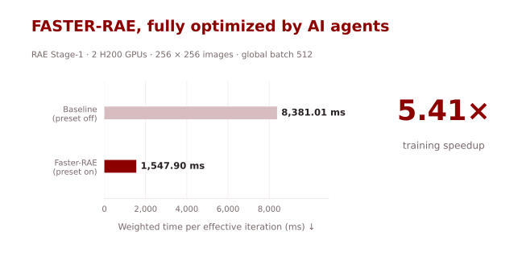
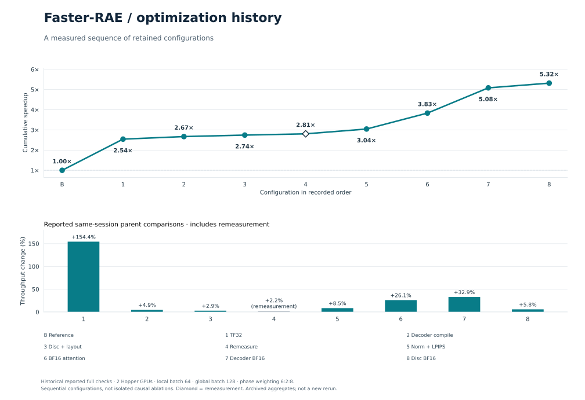
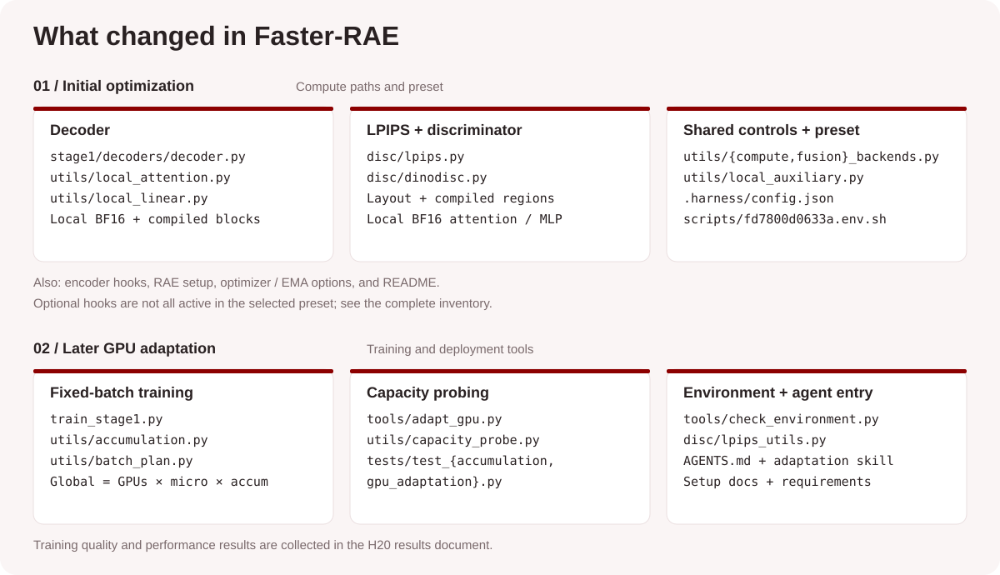

# Faster-RAE

[English](README.md) | [简体中文](README.zh-CN.md)

**5.41× faster RAE Stage-1 training on H200 GPUs, fully optimized by AI agents.**



| Implementation | Weighted iter-time (ms) ↓ | Speedup ↑ |
|---|---:|---:|
| Baseline (optimization switches off) | 8,381.01 | 1.00× |
| **Faster-RAE** | **1,547.90** | **5.41×** |

Measured with DINOv2-B + ViT-XL at 256×256 image resolution.

## Quick Start

On Linux with CUDA, prepare the [environment](docs/agent-environment.md#install-the-runtime) and [data and model weights](docs/agent-environment.md#prepare-assets-once), then launch training. This example uses **8 GPUs**, with 64 images per GPU and global batch 512:

```bash
source scripts/fd7800d0633a.env.sh
export EXPERIMENT_NAME=faster-rae-training
torchrun --standalone --nproc_per_node=8 src/train_stage1.py \
  --config configs/stage1/training/DINOv2-B_decXL.yaml \
  --data-path /path/to/imagenet/train \
  --results-dir results/faster-rae \
  --precision fp32
```

For another GPU count or memory budget, use the [GPU adaptation guide](docs/gpu-adaptation.md) to select a microbatch and accumulation plan while keeping global batch 512.

## Agent Optimization History

The earlier optimization sequence used **2 H200 GPUs, 64 images per GPU, global batch 128**, and the same 6:2:8 phase weighting. Its retained final configuration measured **345.13 ms/step**, **5.3167×** the same-run baseline, and **48.52 GiB** peak memory.



## What changed

- **Decoder:** regional compilation, TF32, and local BF16 attention and linear operations.
- **LPIPS and discriminator:** updated LPIPS memory layout, compiled LPIPS distance calculations and discriminator blocks/normalization, and selected discriminator attention and linear operations in BF16.
- **GPU memory adaptation:** microbatching and gradient accumulation keep the global batch fixed at 512; the adaptation tool checks all three Stage-1 phases before producing a training configuration.

The training precision argument remains `fp32`; the preset enables the selected BF16/TF32 paths. The exact switches are in [`.harness/config.json`](.harness/config.json).



See the [file-by-file review](docs/change-views/review-table.md) for paths and purposes, or open the [interactive file cards](docs/change-views/index.html) locally to filter by module. The map separates the initial optimizations from later GPU adaptation changes; individual speedup contributions require ablation experiments.

## Full-training results

We completed **16 epochs of ImageNet training on 8 H20 GPUs** and evaluated the final EMA model on all **50,000 ImageNet validation images** using the upstream evaluation pipeline.

| Model | PSNR (dB) ↑ | rFID ↓ |
|---|---:|---:|
| Upstream public FP32 decoder | 18.86 | 0.569 |
| **Faster-RAE, final EMA** | **19.00** | **0.541** |

The completed run reached 40,032 generator updates. A separate eight-H20 timing run measured **3.22×** speedup at global batch 512. See [H20 results](docs/h20-results.md) for training quality, timing and test conditions.

## Upstream RAE documentation

Based on [bytetriper/RAE](https://github.com/bytetriper/RAE), by Boyang Zheng, Nanye Ma, Shengbang Tong and Saining Xie. [Paper](https://arxiv.org/abs/2510.11690) · [Project page](https://rae-dit.github.io/) · [MIT license](LICENSE). The original README and upstream authorship are retained below.

<details>
<summary>Original RAE README: environment, data, training and evaluation</summary>

## Diffusion Transformers with Representation Autoencoders (RAE)<br><sub>Official PyTorch Implementation</sub>

### [Paper](https://arxiv.org/abs/2510.11690) | [Project Page](https://rae-dit.github.io/) 


This repository contains **PyTorch/GPU** and **TorchXLA/TPU** implementations of our paper: 
Diffusion Transformers with Representation Autoencoders. For JAX/TPU implementation, please refer to [diffuse_nnx](https://github.com/willisma/diffuse_nnx)

> [**Diffusion Transformers with Representation Autoencoders**](https://arxiv.org/abs/2510.11690)<br>
> [Boyang Zheng](https://bytetriper.github.io/), [Nanye Ma](https://willisma.github.io), [Shengbang Tong](https://tsb0601.github.io/),  [Saining Xie](https://www.sainingxie.com)
> <br>New York University<br>

We present Representation Autoencoders (RAE), a class of autoencoders that utilize  pretrained, frozen representation encoders such as [DINOv2](https://arxiv.org/abs/2304.07193) and [SigLIP2](https://arxiv.org/abs/2502.14786) as encoders with trained ViT decoders. RAE can be used in a two-stage training pipeline for high-fidelity image synthesis, where a Stage 2 diffusion model is trained on the latent space of a pretrained RAE to generate images.

This repository contains:

PyTorch/GPU:
* A PyTorch implementation of RAE and pretrained weights.
* A PyTorch implementation of LightningDiT, DiT<sup>DH</sup> and pretrained weights.
* Training and sampling scripts for the two-stage RAE+DiT pipeline.

TorchXLA/TPU:
* A TPU implementation of RAE and pretrained weights.
* Sampling of RAE and DiT<sup>DH</sup> on TPU.

### Update (Dec. 2025)

We **refactored the codebase** and added support for statistic calculation, training
resumption, Weights & Biases logging, online evaluation, and sanity checks (see the end of the page).
This is a **major update** over the Oct. 2025 release, and some APIs have changed.
Please refer to the [deprecated branch](https://github.com/bytetriper/RAE/tree/deprecated-gpu) for the old codebase.


>Note: You might need to update environment and script accordingly.

## Environment

### Dependency Setup
1. Create environment and install via `uv`:
   ```bash
   conda create -n rae python=3.10 -y
   conda activate rae
   pip install uv
   
   # Install PyTorch 2.8.0 with CUDA 12.9 # or your own cuda version
   uv pip install torch==2.8.0 torchvision torchaudio --index-url https://download.pytorch.org/whl/cu129 
   
   # Install other dependencies
   uv pip install -r requirements.txt
   ```

## Data & Model Preparation

### Download Pre-trained Models

We release three kind of models: RAE decoders, DiT<sup>DH</sup> diffusion transformers and stats for latent normalization. To download all models at once:


```bash

cd RAE
pip install huggingface_hub
hf download nyu-visionx/RAE-collections \
  --local-dir models 
```


To download specific models, run:
```bash
hf download nyu-visionx/RAE-collections \
  <remote_model_path> \
  --local-dir models 
```

### Prepare Dataset

1. Download ImageNet-1k.
2. Point Stage 1 and Stage 2 scripts to the training split via `--data-path`.


## Config-based Initialization

All training and sampling entrypoints are driven by OmegaConf YAML files. A
single config describes the Stage 1 autoencoder, the Stage 2 diffusion model,
and the solver used during training or inference. A minimal example looks like:

```yaml
stage_1:
   target: stage1.RAE
   params: { ... }
   ckpt: <path_to_ckpt>  

stage_2:
   target: stage2.models.DDT.DiTwDDTHead
   params: { ... }
   ckpt: <path_to_ckpt>  

transport:
   params:
      path_type: Linear
      prediction: velocity
      ...
sampler:
   mode: ODE
   params:
      num_steps: 50
      ...
guidance:
   method: cfg/autoguidance
   scale: 1.0
   ...
misc:
   latent_size: [768, 16, 16]
   num_classes: 1000
training:
   ...
eval:
   ...
```

- `stage_1` instantiates the frozen encoder and trainable decoder. For Stage 1
  training you can point to an existing checkpoint via `stage_1.ckpt` or start
  from `pretrained_decoder_path`.
- `stage_2` defines the diffusion transformer. During sampling you must provide
  `ckpt`; during training you typically omit it so weights initialise randomly.
- `transport`, `sampler`, and `guidance` select the forward/backward SDE/ODE
  integrator and optional classifier-free or autoguidance schedule.
- `misc` collects shapes, class counts, and scaling constants used by both
  stages.
- `training` contains defaults that the training scripts consume (epochs,
  learning rate, EMA decay, gradient accumulation, etc.).
- `eval` contains settings for online evaluation during training.

Stage 1 training configs additionally include a top-level `gan` block that
configures the discriminator architecture and the LPIPS/GAN loss schedule.


### Provided Configs:

#### Stage1

We release decoders for DINOv2-B, SigLIP-B, MAE-B, at `configs/stage1/pretrained/`.

There is also a training script for training a ViT-XL decoder on DINOv2-B: `configs/stage1/training/DINOv2-B_decXL.yaml`

> **Note**: In the released training configs, optimization hyperparameters are tuned
to adapt to GPU hardware. The updated configs yield slightly better gFID than the
reported numbers.

#### Stage2

We release our best model, DiT<sup>DH</sup>-XL and it's guidance model on both $256\times 256$ and $512\times 512$, at `configs/stage2/sampling/`.

We also provide training configs for DiT<sup>DH</sup> at `configs/stage2/training/`.

## Stage 1: Representation Autoencoder

### Train the decoder

`src/train_stage1.py` trains the ViT decoder while keeping the
representation encoder frozen. Launch it with PyTorch DDP (single or multi-GPU):

```bash
torchrun --standalone --nproc_per_node=N \
  src/train_stage1.py \
  --config <config> \
  --data-path <imagenet_train_split> \
  --results-dir ckpts/stage1 \
  --image-size 256 --precision bf16/fp32 
```

where `N` refers to the number of GPU cards available.

You need to specify the checkpointing folder by `export EXPERIMENT_NAME="your_experiment_name"` before launching the script. The checkpoints and logs will be saved under `results-dir/$EXPERIMENT_NAME/`. 

**Logging.** To enable `wandb`, firstly set `WANDB_KEY`, `ENTITY`, and `PROJECT` as environment variables:

```bash
export WANDB_KEY="key"
export ENTITY="entity name"
export PROJECT="project name"
```

Then in training command add the `--wandb` flag


**Resuming.** If the checkpoint folder already exists (`results-dir/$EXPERIMENT_NAME/`), the script will automatically resume from the latest checkpoint.

**Online Eval.** The script supports online evaluation during training to monitor reconstruction quality. Paste the following block into the training config:

```yaml
eval:
  eval_interval: 2500 # Eval interval by optimization step
  eval_model: true # By default only evaluates EMA model. Set to true to eval non-EMA model as well.
  data_path: 'data/imagenet/val/' # path to ImageNet val images
  reference_npz_path: 'data/imagenet/val_256.npz' # packed npz of ImageNet val images for FID calculation
  metrics: ['psnr', 'ssim', 'rfid'] # metrics to calculate
```

**torch.compile.** Use `--compile` flag to enable `torch.compile` for potentially faster training. 
### Sampling/Reconstruction

Use `src/stage1_sample.py` to encode/decode a single image:

```bash
python src/stage1_sample.py \
  --config <config> \
  --image assets/pixabay_cat.png \
```

For batched reconstructions and `.npz` export, run the DDP variant:

```bash
torchrun --standalone --nproc_per_node=N \
  src/stage1_sample_ddp.py \
  --config <config> \
  --data-path <imagenet_val_split> \
  --sample-dir recon_samples \
  --image-size 256
```

The script writes per-image PNGs as well as a packed `.npz` suitable for FID.


We also provide an individual script `pack_images.py` to convert a folder of images into a FID-ready `.npz`:

```bash
python src/pack_images.py <image_folder> 
```

### Calculating Encoder Statistics

We use a batchnorm-like normalization layer in the latent space for calculating the mean and variance statistics of the encoder outputs. Specifically, we calculate the mean and variance of the same shape as the latent `[C, H, W]`. To run:

```bash
torchrun --standalone --nproc_per_node=N \
  src/calculate_stat.py \
  --config <config> \ # w/o pre-computed stats
  --sample-dir stats \
  --precision fp32/bf16 \
  --data-path <imagenet_train_split> \
  --image-size 256 \
  --tf32
```

We note that the results may differ slightly from the released statistics because we use a momentum-based update rule for the mean and variance. As a result, the outcome is not deterministic and depends on batch size and data shuffling.

As a reproduction, we ran the script to calculate the statistic of DINOv2-B on 4 GPUs with a batch size of 256 under fp32. The config is exactly the same as `configs/stage1/pretrained/DINOv2-B.yaml` except commenting out the pre-computed stats. The computed variance give around `0.008` L1 difference compared to the released statistics.


## Stage 2: Latent Diffusion Transformer

### Training

`src/train.py` trains the Stage 2 diffusion transformer using PyTorch DDP. Edit
one of the configs under `configs/training/` and launch:

```bash
torchrun --standalone --nnodes=1 --nproc_per_node=N \
  src/train.py \
  --config <training_config> \
  --data-path <imagenet_train_split> \
  --results-dir ckpts/stage2 \
  --precision fp32
```

Although `bf16` is supported, we recommend using **fp32** for more stable training.

The logging and checkpointing behaviour is the same as Stage 1 training.

**Online Eval**: Paste the following block into training config to support online eval:

```yaml
eval:
  eval_interval: 25000 
  eval_model: true
  data_path: 'data/imagenet/val/'
  reference_npz_path: 'data/imagenet/VIRTUAL_imagenet256_labeled.npz'
```

### Sampling

`src/sample.py` uses the same config schema to draw a small batch of images on a
single device and saves them to `sample.png`:

```bash
python src/sample.py \
  --config <sample_config> \
  --seed 42
```

### Distributed sampling for evaluation

`src/sample_ddp.py` parallelises sampling across GPUs, producing PNGs and an
FID-ready `.npz`:

```bash
torchrun --standalone --nnodes=1 --nproc_per_node=N \
  src/sample_ddp.py \
  --config <sample_config> \
  --sample-dir samples \
  --precision fp32/bf16 \
  --label-sampling equal
```
`--label-sampling {equal,random}`: `equal` uses exactly 50 images per class for FID-50k; `random` uniformly samples labels. Using `equal` brings consistently lower FID than `random` by around 0.1. We use `equal` by default. We recommend using fp32 when model FID is low.

Autoguidance and classifier-free guidance are controlled via the config’s `guidance` block.


## Evaluation

### ADM Suite FID setup

Use the ADM evaluation suite to score generated samples:

1. Clone the repo:

   ```bash
   git clone https://github.com/openai/guided-diffusion.git
   cd guided-diffusion/evaluation
   ```

2. Create an environment and install dependencies:

   ```bash
   conda create -n adm-fid python=3.10
   conda activate adm-fid
   pip install 'tensorflow[and-cuda]'==2.19 scipy requests tqdm
   ```

3. Download ImageNet statistics (256×256 shown here):

   ```bash
   wget https://openaipublic.blob.core.windows.net/diffusion/jul-2021/ref_batches/imagenet/256/VIRTUAL_imagenet256_labeled.npz
   ```

4. Evaluate:

   ```bash
   python evaluator.py VIRTUAL_imagenet256_labeled.npz /path/to/samples.npz
   ```

## TorchXLA / TPU support

See `XLA` branch for TPU support.


## GPU training reproduction results:

---
| Model                | rFID-50k (reported) | rFID-50k (reproduced) |
|----------------------|--------------------|--------------------|
| DINOv2-B  ($\tau$ = 0.8)| 0.57 | 0.54 |


| Model  (80 epochs)             | gFID-50k (reported) | gFID-50k (reproduced) |
|---------------------|--------------------|--------------------|
| DiT<sup>DH</sup>-XL (DINOv2-B) |  2.16 | 2.16|
---


## Acknowledgement

This code is built upon the following repositories:

* [SiT](https://github.com/willisma/sit) - for diffusion implementation and training codebase.
* [DDT](https://github.com/MCG-NJU/DDT) - for some of the DiT<sup>DH</sup> implementation.
* [LightningDiT](https://github.com/hustvl/LightningDiT/) - for the PyTorch Lightning based DiT implementation.
* [MAE](https://github.com/facebookresearch/mae) - for the ViT decoder architecture.

</details>
