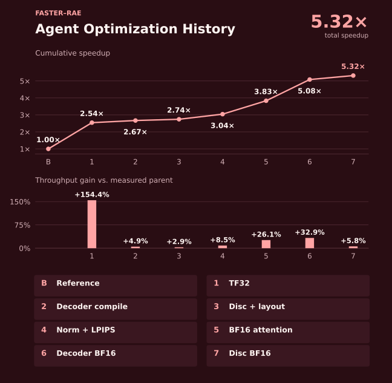
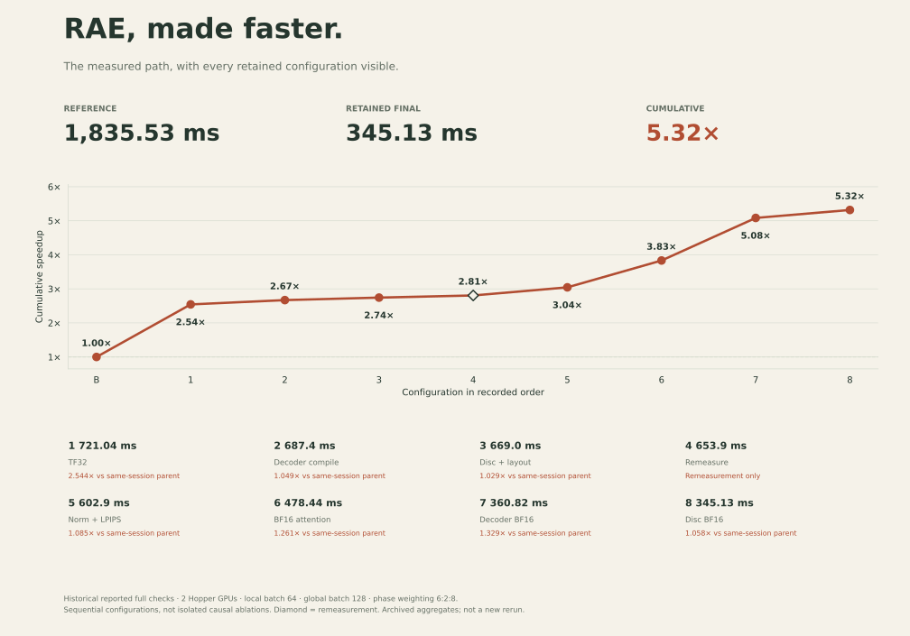

# 优化过程：三种图表版本

三个版本使用同一份 [measurement-history.json](measurement-history.json)，仅改变表达形式。推荐 README 放论文版，演示用深色版，需要同时读耗时和父版本收益时用卡片版。

| 版本 | 表达重点 | 下载 |
| --- | --- | --- |
| 01 · Paper | 累计加速折线 + 每次同场父版本的吞吐提升柱状图 | [SVG](01-paper.svg) · [PNG](01-paper.png) · [PDF](01-paper.pdf) |
| 02 · KDA-inspired | 深色进展折线，顶部里程碑和虚线箭头 | [SVG](02-kda-dark.svg) · [PNG](02-kda-dark.png) · [PDF](02-kda-dark.pdf) |
| 03 · Editorial | 摘要数字、折线、每个阶段的耗时与父版本收益卡片 | [SVG](03-editorial.svg) · [PNG](03-editorial.png) · [PDF](03-editorial.pdf) |






## 如何读这些数字

- 横轴 B 是上游 FP32 参考，1–8 是历史保留配置的顺序，不是训练 iteration，也不是等间隔日期。
- 折线直接使用历史完整检查所报告的累计加速比，各次检查都有自己的成对参考；不拿四舍五入后的耗时重新计算更精确的比值。
- 论文版下方的百分数为 `(parent_speedup - 1) × 100%`，表示报告中同场父版本比较的吞吐变化。它不等于相邻两次历史耗时的比值，也不是耗时缩短百分数，各项不能相加。
- 第 4 点为空心菱形，对应同一组优化配置换父版本后重测，**不是新增优化**；它在收益柱状图中用灰色显示。
- 这些是按顺序叠加的配置，不是逐个文件或单个开关的独立因果消融。文件关联说明现在的实现位置，不能解释成该文件单独带来相应收益。
- 数据来自已有汇总报告，本次没有重跑这条历史序列，也没有独立核验原始逐候选账本。来源摘要、SHA256、保留精度和限制见 JSON。

## 不同硬件和 batch 的结果分开读

这条曲线对应历史 **2 张 H200-class/Hopper、每卡 batch 64、global batch 128** 的加权计时，重建／判别器／GAN 三阶段权重为 **6:2:8**。终点为 5.3167×，历史记录的耗时为 345.13 ms。

仓库首页的 **8×H20、global batch 512、3.22×** 是另一次独立实测；2 卡累积 4 次、global batch 512 的 5.41× 也是独立实测。它们没有连接进历史曲线。适配工具仍默认保持上游 global batch 512；历史 global batch 128 不构成推荐训练配置。

未通过收益门槛的候选 `4ee76f` 只完成筛选：341.51 ms、相对同场父版本 1.008×，没有进入完整检查，因此没有被画成新的保留终点。质量、数值等价和当前代码版本的限制继续以仓库 README 与验证文档为准。

## 重新生成

需要 Python 3.10+ 和 matplotlib 3.8+；本次生成环境为 matplotlib 3.10.8。无 GPU、网络、模型或数据集依赖。

```bash
python3 docs/performance-views/render_charts.py
```

脚本直接读取 JSON 中的 `speedup`、`parent_speedup`、`iter_ms`，导出三种样式的 SVG、PNG、PDF。生成后检查 PNG 的标题、节点标注、箭头和脚注布局。

## 样式参考

深色版参考了 NVlabs KDA² 的 [ProgressTimeline 原始源码](https://github.com/NVlabs/kda/blob/pages/app/blog/2026-09-27-kda-for-kda/timeline.tsx)：顶部里程碑、虚线箭头、关键节点和末端数字的组织方式。本仓库使用新写的 matplotlib 实现，未复制该 React/SVG 源码。图中 RAE 数据与 KDA 性能数据无关。
